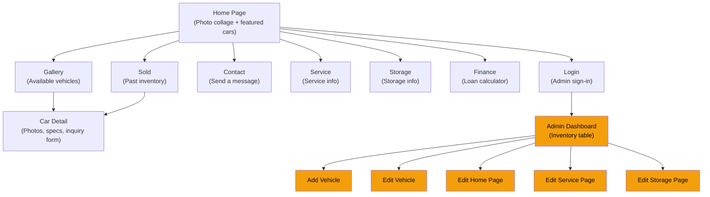
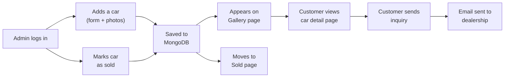
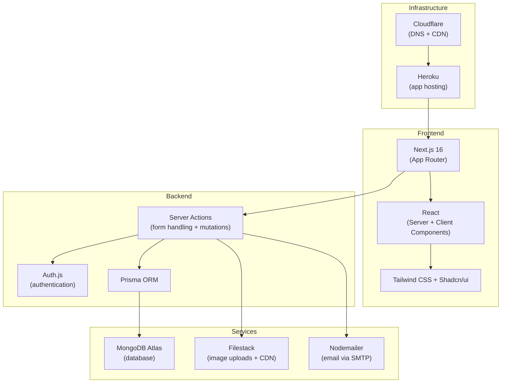

# Authentic Motorcars - Project Overview

**Last Updated:** February 14, 2026

---

## What Is This?

Authentic Motorcars is a website for a car dealership. It lets visitors browse available vehicles, view detailed photos, and send inquiries. The dealership owner manages inventory, page content, and photos through a protected admin panel.

### Key Features

- **Public gallery** of available vehicles with photos, specs, and inquiry forms
- **Sold vehicle archive** so past inventory remains visible
- **Contact and inquiry forms** that send emails to the dealership
- **Loan calculator** for financing estimates
- **Service and storage pages** with editable content
- **Admin dashboard** for managing everything (protected by login)

---

## Site Map

_Orange = admin-only pages (requires login)_

---

## How Data Flows

This is the lifecycle of a car listing, from the admin adding it to a customer sending an inquiry:

---

## Tech Stack

---

## Quick Links

| What | Where |
|------|-------|
| Full architecture details | [`ARCHITECTURE.md`](ARCHITECTURE.md) |
| Local development setup | [`HOW_TO_RUN.md`](HOW_TO_RUN.md) |
| Database schema | [`prisma/schema.prisma`](prisma/schema.prisma) |
| Server actions | [`src/actions/`](src/actions/) |
| Page routes | [`src/app/`](src/app/) |
| Components | [`src/components/`](src/components/) |
| Auth configuration | [`src/lib/auth.ts`](src/lib/auth.ts) |
| Environment variables | [`ARCHITECTURE.md` Section 10](ARCHITECTURE.md#10-environment-variables) |
